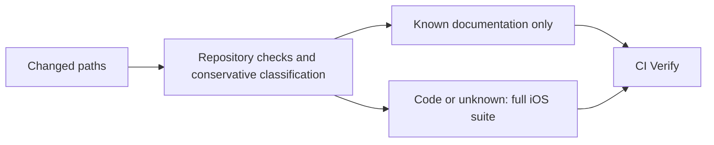

# Resource efficiency

Keep prepared narration, bundled playback and local SwiftData history as the prototype's operating model. There is no hosted speech, backend, cloud sync or analytics dependency to budget during a nap. Local hardware, development tools and distribution can still have costs.

## Implemented priorities

| Area | Behavior | Verification |
| --- | --- | --- |
| Listening history | Each durable save updates its affected published entry; complete history validation is reserved for opening/recovery. Five-second checkpoint timing, final-over-checkpoint rules, surfaced errors and retry remain intact. | Large-history ordering, replacement, retry and disk-reopen tests in `ListeningHistoryStoreTests`. |
| CI | Known documentation-only PRs can omit macOS. Production, test, resource, project, workflow and unknown changes retain the full simulator gate. Manual runs retain full coverage. | Portable Git-fixture classification and readiness-policy tests; the stable `CI Verify` check rejects missing/failed required work. |
| Local feedback | The test runner supports an explicit host-test-only mode while its default remains the full unit/UI suite. | Portable runner command/exit/result tests; see [Development](Development.md). |

The full iOS suite remains required for executable changes. Faster feedback is not a claim of measured battery savings or permission to remove platform acceptance tests. Keep Actions pinned, credentials unpersisted, superseded runs cancelled, and failed simulator artifacts short-lived. A public repository's standard hosted compute is free under current GitHub terms; avoid adding paid runners or large caches without measured benefit.

## Follow-ups with explicit acceptance requirements

| Recommendation | Evidence / trigger | Before changing behavior |
| --- | --- | --- |
| Smaller narration delivery assets | The 20 October 2026 desktop experiment reduced the two PCM narration files from 71.25 MB to 9.02 MB with 48 kb/s mono AAC; native decoded durations matched. | Preserve approved PCM masters and provenance. Obtain listening acceptance and production seeking/resume, identity, natural completion, interruption and fixed-cutoff checks. Existing saved render fingerprints cannot silently point at re-encoded audio. No encoded file is shipped by this change. |
| Local output retention | The same audit identified about 3.49 GB of ignored preparation and diagnostic output. This is a candidate pool, not guaranteed reclaimable storage. | Distinguish reproducible build output from unique device/trial evidence and pinned preparation inputs. No cleanup is performed automatically. |
| Prepared inventory reuse | Several screens resolve catalog and ambience independently. The present catalog is small. | Profile launch/navigation; cache by actual bundle/resource identity and retain missing/corrupt-resource validation. |
| Lazy Feasibility Lab activation | Experimental audio machinery is created by the app root. | Profile ordinary startup; preserve production object lifetimes and access to any separately scheduled test alarm. |
| Offline renderer memory | Preparation retains multiple full-session arrays and uses an isolated model environment. | Measure peak memory/render time as content grows. Pin environment inputs and characterize PCM construction/provenance before streaming or vectorizing it. |

The [architecture](Architecture.md), [history contract](Nap-Planning-Domain.md), [audio preparation guide](Audio-Preparation.md) and [decision log](Decision-Log.md) own the underlying guarantees. Device comfort, audible alarm behavior and subjective audio quality remain separate from automated implementation checks.
