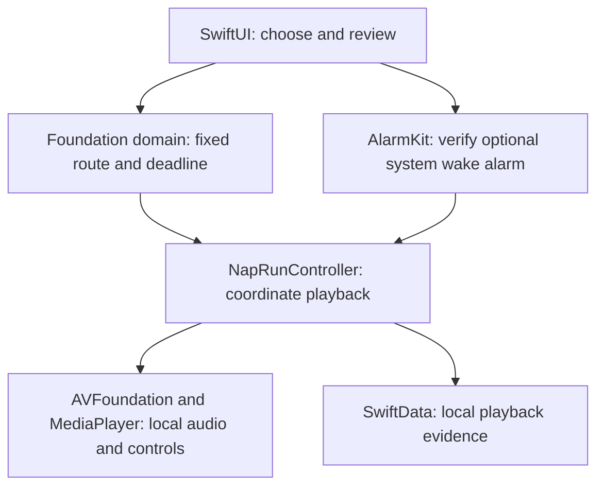

# Honkshool: project and interview reference

Honkshool is an experimental native iPhone app for calm factual narration during naps and bedtime. A listener chooses a session and rest window, reviews a fixed plan, and hears prepared narration followed by rain or silence, with an optional system wake alarm. Rest comes first; playback does not establish learning or a health outcome.

This reference captures the November 2026 project walkthrough. It is a learning aid, not a replacement for the canonical [project overview](Project-Overview.md), [architecture](Architecture.md), [decision log](Decision-Log.md), or [roadmap](Project-Implementation-Plan.md). The future options below are discussion proposals, not implemented capabilities or accepted delivery commitments.

## The current stack



All of this runs on the phone. The main layers are conceptual modules inside one app target, with a separate alarm Live Activity extension; they are not separate Swift packages or network services.

| Technology | Job in Honkshool | Starting point |
| --- | --- | --- |
| Swift and SwiftUI | Native application logic, Rest/History screens, Settings and plan review. The project targets iOS 26+ and declares Swift 5 language mode; that is not a claim about the installed compiler version. | [App entry](../Honkshool/App/HonkshoolApp.swift), [project settings](../Honkshool.xcodeproj/project.pbxproj) |
| Foundation | Content identity, session allocation, immutable reviewed plans, completion and resume rules without depending on UI, audio or storage frameworks. | [NapPlanner](../Honkshool/Domain/NapPlan.swift), [playback domain](../Honkshool/Domain/NapPlayback.swift) |
| Combine and Swift concurrency | Observable state updates screens; main-actor controllers and asynchronous tasks coordinate platform work. | [NapRunController](../Honkshool/Services/NapRunController.swift) |
| AVFoundation and MediaPlayer | File playback, audio-session handling, interruptions, and Lock Screen media controls. | [Run controller](../Honkshool/Services/NapRunController.swift), [rain player](../Honkshool/Services/NapAmbiencePlayer.swift) |
| AlarmKit | Authorize, schedule, verify, reconcile and cancel the separately tracked wake alarm. | [NapPlanAlarmService](../Honkshool/Services/NapPlanAlarmService.swift) |
| WidgetKit, ActivityKit and App Intents | System-hosted alarm Live Activity/interaction, including snooze presentation. | [Alarm extension](../HonkshoolAlarmWidget/HonkshoolAlarmWidget.swift), [shared metadata and intents](../Honkshool/Shared/HonkshoolAlarmMetadata.swift) |
| SwiftData and UserDefaults | Versioned local listening-history storage and lightweight preferences. Audio files are bundled resources, not stored as SwiftData records. | [History store](../Honkshool/Services/ListeningHistoryStore.swift), [preferences](../Honkshool/App/RestPreferences.swift) |
| Xcode, XCTest/XCUITest and GitHub Actions | Build, unit/service/UI checks, portable publication checks and CI readiness gates. Shell and standard-library Python support repository tooling. | [Development guide](Development.md), [workflow](../.github/workflows/ci.yml) |
| Python and Kokoro | Generate narration during content preparation on a computer; neither the Python environment nor the speech model ships in the app. | [Preparation tool](../scripts/prepare-kokoro-narration.py), [audio guide](Audio-Preparation.md) |

The current catalog has two ordered automotive sessions. There is no app backend, account, analytics, app-managed cloud sync, download manager or runtime AI generation. See [privacy](Privacy.md) and the [content catalog](Content-Catalog.md).

## What happens when someone starts a nap

1. **Choose.** SwiftUI collects the session, duration or wake time, sound and alarm preference. No audio starts merely by changing a setting.
2. **Plan and review.** `NapPlanReviewView` creates a request and `NapPlanner.makePlan` selects the route that fits. If no complete session fits, the plan uses the selected available ambience or silence. Confirmation preserves the reviewed route and deadline.
3. **Verify the alarm.** If requested, `NapPlanAlarmService` schedules the AlarmKit alarm and checks that the returned evidence matches the fixed deadline. Permission or scheduling failure blocks an alarm-enabled start.
4. **Start playback.** `NapRunController` validates the approved plan, schedules its start and cutoff, and plays the approved bundled files through AVFoundation. The user must keep the app foregrounded until the planned playback begins; a silence-only plan instead reaches its visible rest-until-deadline state.
5. **Handle controls and interruptions.** MediaPlayer connects system playback controls. The controller manages pause/resume, interruptions and output loss, with explicit recovery. Pausing never moves the deadline.
6. **Record evidence.** The controller saves verified partial checkpoints and completed narration to `ListeningHistoryStore`. Actual completion advances journey progress; estimates, rain and silence do not prove narration completion.
7. **Finish or return later.** Audio is intended to stop at the fixed deadline. Stopping playback early leaves a scheduled wake alarm active until explicitly cancelled. History's Continue/Resume/Replay opens a fresh review; reopening never starts audio automatically.

Read the flow in [NapPlanReviewView](../Honkshool/App/NapPlanReviewView.swift), [NapRunController](../Honkshool/Services/NapRunController.swift), and [ListeningHistoryView](../Honkshool/App/ListeningHistoryView.swift). Timing and progress guarantees belong to the [domain contract](Nap-Planning-Domain.md); real-device execution remains subject to the acceptance limits below.

## Why Kokoro, and why prepared recordings?

These were two separate decisions:

- **Voice choice, recorded rationale:** listening comparisons found Kokoro Heart and George more natural than the Apple auditions. George's calm documentary character was preferred, with model speed `0.86` for more spacious delivery. This was a listening preference, not an exhaustive benchmark of speech vendors. See [D-023](Decision-Log.md#kokoro-narration-direction-2026-09-21).
- **Preparation choice, recorded rationale:** generate recordings beforehand and bundle the result to preserve reviewed sound and measured duration without a large model and inference runtime on the phone. See [D-024](Decision-Log.md#prepared-kokoro-playback-2026-09-21).

```text
Written script → local Python/Kokoro preparation → reviewed WAV + provenance
              → bundled iPhone resource → AVFoundation playback during a nap
```

Generation itself does not require a hosted speech service. Once the preparation environment and model assets are installed, the renderer operates offline. During a nap the app plays a recording; it does not synthesize live speech.

| Benefit of prepared audio | Tradeoff |
| --- | --- |
| Exact recording can be checked before publication. | Script, voice or pacing changes require regeneration and review. |
| Measured duration supports planning. | Each voice/pacing variant needs its own audio and timing. |
| No synthesis workload during rest. | Recordings consume storage as the catalog grows. |
| Local Kokoro avoids metered speech-generation fees. | Preparation tools, licenses and quality checks still need maintenance. |

The two current lossless narration WAVs total 71,250,088 bytes, about 68 MiB. The pinned original model checkpoint is about 327 MB; this is a historical preparation comparison, not a size guarantee for every possible iPhone model format. The [audio guide](Audio-Preparation.md) owns exact provenance and environment details.

## Future growth: proposed audio delivery

**Recommended direction discussed:** keep a bundled starter collection, then offer prepared recordings as downloads that remain playable offline. Hundreds of sessions do not require every listener to store the entire catalog.


This would add a network boundary before the nap, while retaining local playback:

| Proposed addition | Role and integration |
| --- | --- |
| Cloudflare R2 and CDN | Host versioned recordings; deliver through a custom domain with appropriate caching. This is a candidate service, not a configured Honkshool dependency. Storage and operations cost money; R2 currently has no internet egress bandwidth fee. Recheck terms before adoption. |
| Versioned JSON catalog | Describe sessions, durations, file sizes, URLs and checksums. A public catalog could start without a custom application server or cloud database. Private/paid content would require a separate access design. |
| URLSession download manager | Download to disk, handle retries/background transfer, and verify complete files before marking them ready. SwiftUI would display progress and offline availability. |
| Local inventory | SwiftData tracks availability, recording versions, pinned sessions and storage use. Files live in persistent app storage. Content resolution expands from bundled-only to bundled-or-downloaded sources. |
| Storage and update rules | Protect all files in an approved active route. Verify a new recording before replacing an old one, and preserve render identity so changed audio cannot silently inherit an incompatible resume position. |

No plan should start until its entire narration route is locally available and verified. Keep a local catalog snapshot so browsing downloaded sessions and planning do not depend on a successful network refresh. A connection failure during the nap should not affect its audio.

The app's runtime would still use the existing planner, AVFoundation playback, AlarmKit and local history. Download completion would not start playback. No service is provisioned or network behavior added by saving this reference.

Sources checked November 9, 2026: [Cloudflare delivery](https://developers.cloudflare.com/r2/buckets/public-buckets/), [R2 pricing](https://developers.cloudflare.com/r2/pricing/), and [Apple background downloads](https://developer.apple.com/documentation/foundation/downloading-files-in-the-background).

### Could the phone generate audio instead?

Yes, as a future experiment: install the model, voice and scripts, generate a complete recording locally, measure it, then review and play it through the existing system. A community [Kokoro Swift implementation](https://github.com/mlalma/kokoro-ios) provides an iOS path using MLX. Its reported performance does not establish Honkshool compatibility, target-device performance or voice parity.

On-device generation reduces the need to download individual recordings and could support personalized scripts or many voice variants. It adds a model installation, generation wait, memory/battery workload, dependency maintenance and recovery paths. Saving generated recordings still consumes storage. Long-session sound, generation time, peak RAM, energy use and locked/background behavior would need measurement. Generation should finish before a nap rather than becoming a dependency during rest.

For the shared curated catalog, the recommendation remains prepared downloads. Revisit local generation when a concrete personalization requirement or measured delivery constraint justifies it.

### Optimize time, memory, or both

Here **time** means waiting before playback, **RAM** means temporary working memory, and **storage** means saved files. Unlimited engineering resources do not remove the phone's limits.

| Goal | Proposed approach | Accepted cost |
| --- | --- | --- |
| Fastest readiness | Centrally prepare recordings, download selected journeys ahead, and retain a generous offline library. | More storage and potentially unused downloads; an undownloaded session still needs preparation. |
| Lowest RAM/storage | Avoid a local speech model, use quality-tested compressed recordings, download directly to disk, and keep a small offline library. | More frequent downloads and fewer choices offline. |
| Balance both | Keep starter sessions, pinned journeys and the next few sessions offline; prefetch ahead and evict only unpinned, inactive files within a storage budget. | Additional inventory and download logic. This is the recommended growth approach. |

Compression primarily reduces disk use and download size; playback RAM must be measured separately. The [efficiency note](Efficiency.md) records a desktop AAC experiment that reduced the two recordings from 71.25 MB to 9.02 MB. Those encoded files are not shipped or accepted production replacements. Listening, seeking/resume, completion, interruptions, cutoff and recording identity need validation before changing delivery assets.

## Explain it in an interview

> Honkshool is a native iPhone prototype that combines calm factual narration with timed rest. Its Swift planning layer fixes the route and deadline before playback. Apple frameworks handle local audio, system alarms and listening history. Narration is generated beforehand with Kokoro, so the phone plays reviewed recordings offline. The interesting engineering work is coordinating interruptions, deadlines and saved progress without silently changing the user's plan.

Use this as a project description. Add personal contribution claims only when accurate, and describe AI or collaborator assistance honestly. This reference does not establish independent authorship, user scale, measured product impact or production readiness.

Useful technical discussion topics are the separation of planning rules from platform adapters, playback versus completion evidence, independent alarm ownership, and the tradeoff between prepared downloads and on-device generation.

## Evidence, baseline and learning snapshots

| Field | Reference |
| --- | --- |
| Identity | [joshuawyadao/Honkshool](https://github.com/joshuawyadao/Honkshool); source root is the repository root (`.`). Private machine paths are intentionally omitted. |
| Initial briefing | November 3, 2026, America/Los_Angeles; `main` at `3434c5e0c1f30d040c316dd7ca8ba97769d88f7e`; clean checkout. Default comparison was the preceding 30 days of available history. |
| Saved-reference baseline | November 9, 2026, America/Los_Angeles; started from clean `main` at `b0164525c4718705787f9af093490e2461b3a99e`; saved on `codex/project-interview-reference`. Compare `3434c5e..b016452` for changes since the first briefing. |
| Change since briefing | `b016452` updates offline narration preparation tooling and documentation with recorded audio parity. It does not add runtime synthesis or hosted delivery. |
| Current save | Documentation-only local changes at authoring: this reference, the docs index and the replaceable task plan. Publication and review status belong to the PR, not this historical baseline. |
| Validation boundary | Source and existing tests inspected for this reference; no app or simulator suite rerun to establish runtime acceptance. Repository verification for the documentation change is recorded in the task plan/PR. Recorded historical passes are not fresh test results. |
| Product limit | Experimental prototype with no supported release. Full production-path device/listening acceptance and the personal trial remain pending as described in the project overview. Committed source does not establish deployed state. |

### Learning log

| Snapshot | Covered | Learner context and next evidence |
| --- | --- | --- |
| November 3 initial orientation | Purpose, stack, module boundaries and nap-start walkthrough. | Interview/networking preparation requested. This records topics covered, not assessed proficiency. |
| November 9 follow-up and save | Kokoro selection; offline preparation; downloads versus local generation; proposed hosting and time/RAM/storage tradeoffs. | The learner reported a good understanding and requested this reference. No quiz or mastery assessment was performed. |

### Open questions for a later review

- Has device/listening acceptance or the personal trial progressed since this snapshot?
- Have downloads or on-device generation become an approved requirement? Neither is authorized for implementation by this reference.
- What are measured download sizes, wait times, peak RAM and device energy costs for any proposed replacement?
- Which personal contributions and outcomes can be substantiated for an interview?

On the next catch-up, compare this baseline with the new revision, append a dated snapshot, and refresh only the changed facts. Preserve the earlier learning and evidence boundaries.
